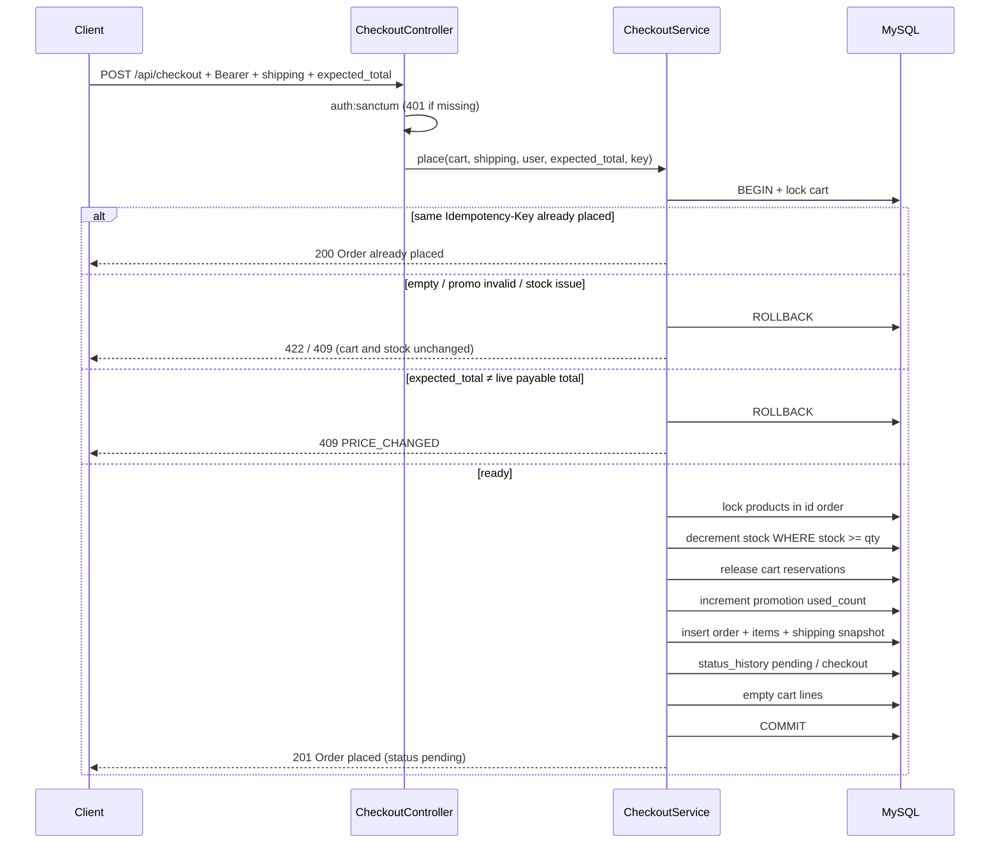
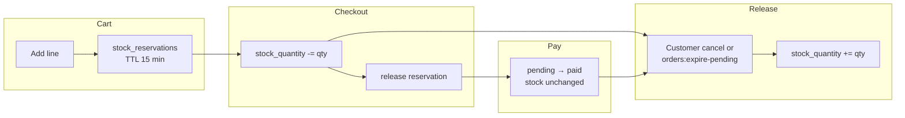
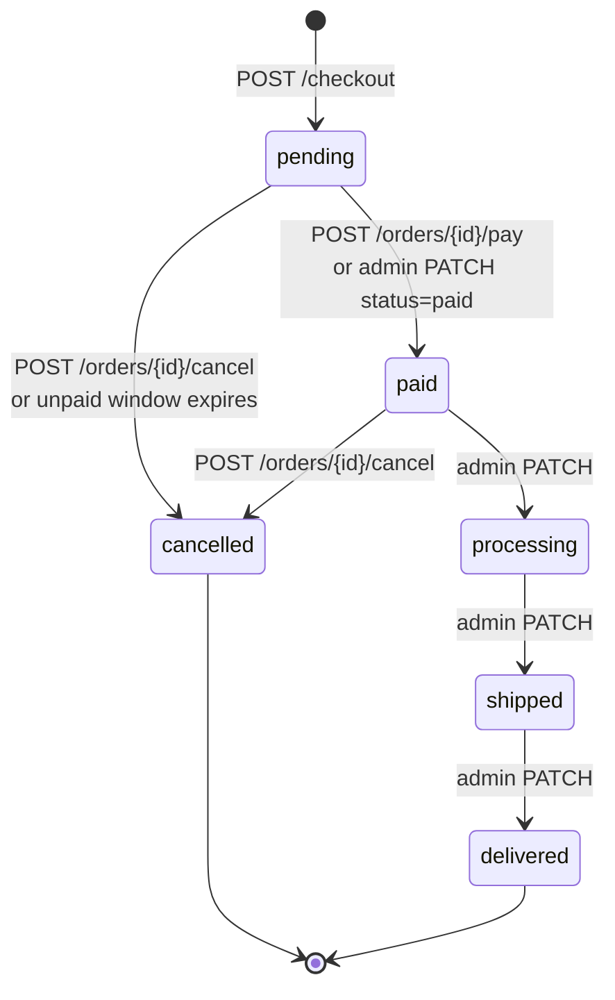
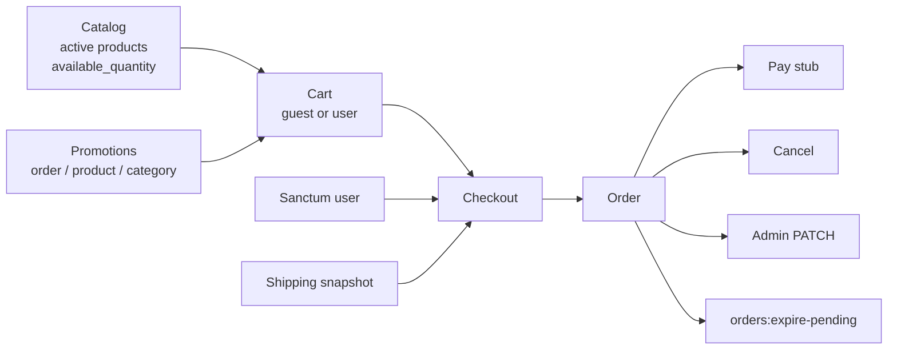

# Orders and checkout

This is the shopper-to-fulfilment path in this API. Checkout requires a logged-in customer. Guests may browse and fill a cart with `X-Cart-Token`; they must register or log in before `POST /api/checkout`.

Request bodies and examples: [`dgt-assessment.postman_collection.json`](../dgt-assessment.postman_collection.json). Coverage: PHPUnit (`php artisan test`) plus curl smoke (`scripts/api-smoke-test.ps1`).

---

## 1. What checkout actually does

`POST /api/checkout` is the only way a customer creates an order. Client money fields (`price`, `subtotal`, `total`) are ignored as the charge. `expected_total` is required: it is the payable total last shown on `GET /cart` (`data.total`), compared in integer cents against the live catalog. It is a confirmation, not the amount billed. Rate limit: 10 req/min per customer (`throttle:checkout`).

Required body:

```json
{
  "expected_total": "430.00",
  "shipping": {
    "name": "Maya Daher",
    "phone": "+961 70 123 456",
    "address_line1": "Hamra St., Building 12, Floor 3",
    "address_line2": "Apartment 5",
    "city": "Beirut",
    "state": "Beirut Governorate",
    "postal_code": "1103",
    "country": "Lebanon"
  }
}
```

Shipping values are copied onto `orders.shipping_*` at place time (`ShippingAddress`). Later profile edits cannot rewrite them. An idempotent retry with the same `Idempotency-Key` (header or body, 8–100 chars) returns the original order and the original address (`200 Order already placed.`) without re-checking `expected_total` — the sale already exists.

The cart does **not** freeze a quoted price. `GET /cart` always re-reads `products.price`. If the catalog (or a still-valid promo) moved between that GET and place, checkout returns `409 PRICE_CHANGED` with `details.expected_total` / `current_total` / `current_subtotal` / `current_discount`. No order, stock unchanged. The client shows the new total and retries with that `expected_total`. `"50"` and `"50.00"` match. Missing or malformed `expected_total` is `422 VALIDATION_FAILED`.

`GET /api/checkout/shipping` returns that snapshot from the customer's newest order (`data.shipping`), or `null` if they have never checked out. There is no address-book table; `POST /checkout` still requires a full `shipping` object.



Inside one transaction (`CheckoutService::place`):

1. Lock the cart row.
2. Replay if `(idempotency_scope = u:{userId}, idempotency_key)` already exists (`200`).
3. Recalculate lines from live catalog (active, price, available stock).
4. Fail closed if empty, promo invalid, product unavailable, or insufficient stock.
5. Compare `expected_total` to the live payable total (subtotal − discount, integer cents). Mismatch → `409 PRICE_CHANGED`.
6. Decrement on-hand stock (`WHERE stock_quantity >= quantity`).
7. Drop the cart’s TTL reservations so units are not held twice.
8. Consume the promotion (usage row + `used_count`).
9. Insert the order, item snapshots (name, SKU, unit price), and shipping columns. Stamp `payment_due_at` (default 30 minutes from `ORDERS_UNPAID_PENDING_MINUTES`).
10. Record `pending` with source `checkout` (`OrderStatusRecorder`).
11. Clear cart items and the applied code.

On commit of a **new** order: `OrderPlaced` is dispatched and the catalog cache is bumped. An idempotent replay does neither. Two overlapping checkouts lock product rows in **id order**. The second buyer gets `409 INSUFFICIENT_STOCK` if the first already took the last units. Two retries with the same key that both pass the SELECT collide on the unique index; the loser rolls back and returns the winner.

Checkout failures that leave cart and stock unchanged: `401 UNAUTHENTICATED`, `422 VALIDATION_FAILED` (missing `expected_total` / shipping), `422 CART_EMPTY`, promo errors (`PROMOTION_*`), `422 PRODUCT_UNAVAILABLE`, `409 INSUFFICIENT_STOCK`, `409 PRICE_CHANGED`.

---

## 2. Inventory: hold, then commit, then maybe restore

On-hand `products.stock_quantity` does **not** drop when someone adds to cart. Carts write `stock_reservations` with a 15-minute TTL (`CART_RESERVATION_TTL_MINUTES`). Storefront `available_quantity` is on-hand minus active holds. `cart:expire-reservations` (every minute) drops expired holds and idle guest carts (`CART_IDLE_DAYS`).



| Moment | On-hand stock | Available to others |
|---|---|---|
| Add to cart | Unchanged | Lower (reservation) |
| Reservation expires / idle guest cart pruned | Unchanged | Back |
| Successful checkout | Decremented | Lower. `payment_due_at` is stamped (default 30 minutes). |
| Pay stub before the window | Unchanged | Unchanged. The order is no longer eligible for expiry. |
| Customer cancel while `pending` or `paid` | Restored | Back |
| Unpaid `pending` past `payment_due_at` | Restored by `orders:expire-pending` | Back |
| After `processing` / `shipped` / `delivered` | Stays decremented | Cancel and expiry both rejected |

Checkout `increment`/`decrement` does **not** write product price/stock audits. Those audits are admin catalog edits only.

---

## 3. Order lifecycle



| Status | Who moves it | Side effects |
|---|---|---|
| `pending` | Checkout | Stock committed, shipping snapshotted, cart emptied, `payment_due_at` set |
| `paid` | Owner `POST .../pay` (stub) or admin PATCH | `paid_at` stamped once; stock not touched again |
| `processing` | Admin only | `processing_at` |
| `shipped` | Admin only | `shipped_at` |
| `delivered` | Admin only | `delivered_at`. Terminal |
| `cancelled` | Owner `POST .../cancel`, or `orders:expire-pending` for unpaid `pending` | Stock restored, promo usage released, `cancelled_at` |

Rules:

- Admin **cannot** skip (`pending` → `shipped` is `422 INVALID_ORDER_TRANSITION` with `allowed_statuses`).
- Admin **cannot** cancel via `PATCH`. Cancel restores inventory and must use `POST /api/orders/{id}/cancel` (`422` if `status=cancelled` on PATCH).
- Pay and cancel are **idempotent**: a second call is `200` (`Order already paid.` / `Order already cancelled.`) with no extra stock or timestamp change.
- Only the owning customer can pay or cancel (`OrderPolicy`). Admins can view and advance fulfilment (`view`, `viewAll`, `update`), not capture or cancel someone else’s order (`403 FORBIDDEN`).
- Each transition appends an append-only `order_status_changes` row. Sources: `checkout`, `payment`, `admin`, `cancel`, `expiry`. Updates to those rows throw.
- After a **real** change (pay, admin fulfilment, cancel, expiry) the API dispatches `OrderStatusChanged`. Idempotent replays do not. Checkout uses `OrderPlaced`. Queued listeners `LogOrderPlaced` and `LogOrderStatusChanged` write structured `info` logs (no mail).
- Unpaid `pending` orders hold stock until pay, cancel, or `payment_due_at`. `orders:expire-pending` (every minute) cancels only `pending` through `CancelOrderService` with source `expiry` (no actor). Paid orders are never expired.

---

## 4. HTTP surface

All paths are under `/api`. Bearer Sanctum unless noted. Envelope: `{ success, message, data }` or `{ success, message, code, errors?, details? }`.

### Customer

| Method | Path | Notes |
|---|---|---|
| `GET` | `/checkout/shipping` | Last order snapshot or `null` |
| `POST` | `/checkout` | 10 req/min. Requires `expected_total` + `shipping`. `Idempotency-Key` recommended |
| `GET` | `/orders` | Own orders. Query: `status`, `from`, `to`, `per_page` (1–100), `page` |
| `GET` | `/orders/{id}` | Owner or admin |
| `POST` | `/orders/{id}/pay` | Owner. `pending` → `paid`. 10 req/min |
| `POST` | `/orders/{id}/cancel` | Owner. `pending` or `paid`. 10 req/min |

### Admin (`role:admin`)

| Method | Path | Notes |
|---|---|---|
| `GET` | `/admin/orders` | All orders. Query: `status`, `user_id`, `search` (number / email / name), `from`, `to`, pagination |
| `GET` | `/admin/orders/{id}` | Customer + items + totals + history + `allowed_statuses` |
| `PATCH` | `/admin/orders/{id}` | `{ "status": "processing" }` one step forward |

### Error codes on this path

| Code | When |
|---|---|
| `UNAUTHENTICATED` | Missing/invalid token |
| `FORBIDDEN` | Not owner (pay/cancel) or not admin (admin routes) |
| `RESOURCE_NOT_FOUND` | Unknown order |
| `VALIDATION_FAILED` | Bad shipping, missing `expected_total`, filters, or `status` |
| `CART_EMPTY` | Checkout with no lines |
| `PRICE_CHANGED` | `expected_total` ≠ live payable total (catalog or promo moved) |
| `INSUFFICIENT_STOCK` | Decrement lost the race or cart over available |
| `PRODUCT_UNAVAILABLE` | Inactive / deleted product still in cart |
| `PROMOTION_*` | Invalid, inactive, window, limits, minimum, not applicable |
| `ORDER_NOT_PAYABLE` | Pay while not `pending` |
| `INVALID_ORDER_STATUS` | Cancel while processing/shipped/delivered |
| `INVALID_ORDER_TRANSITION` | Admin skip or illegal PATCH |
| `TOO_MANY_REQUESTS` | Checkout/pay/cancel 10/min |

### What a placed order looks like

```json
{
  "id": 1,
  "order_number": "ORD-20261013-AB12CD34",
  "status": "pending",
  "email": "customer@example.com",
  "shipping": {
    "name": "Maya Daher",
    "phone": "+961 70 123 456",
    "address_line1": "Hamra St., Building 12, Floor 3",
    "address_line2": "Apartment 5",
    "city": "Beirut",
    "state": "Beirut Governorate",
    "postal_code": "1103",
    "country": "Lebanon"
  },
  "customer": { "id": 2, "name": "Demo Customer", "email": "customer@example.com", "role": "customer" },
  "items": [
    {
      "id": 1,
      "product_id": 8,
      "product_name": "Limited Edition Sneakers",
      "product_sku": "SNK-LTD-001",
      "unit_price": "120.00",
      "quantity": 4,
      "line_total": "480.00"
    }
  ],
  "items_count": 1,
  "subtotal": "480.00",
  "discount": "50.00",
  "total": "430.00",
  "promotion": { "id": 1, "code": "SUMMER20" },
  "payable": true,
  "cancellable": true,
  "payment_due_at": "2026-10-13T12:30:00+00:00",
  "status_history": [
    { "id": 1, "from_status": null, "to_status": "pending", "source": "checkout", "created_at": "2026-10-13T12:00:00+00:00" }
  ],
  "created_at": "2026-10-13T12:00:00+00:00",
  "paid_at": null,
  "processing_at": null,
  "shipped_at": null,
  "delivered_at": null,
  "cancelled_at": null
}
```

Admin show also includes `allowed_statuses` (next legal PATCH values). Item name, SKU, and unit price are frozen.

---

## 5. Surrounding modules that feed checkout



- **Catalog** — public list/detail; `available_quantity` overlays reservations; admin CRUD, soft-delete, restore.
- **Cart** — guest token or user; server-side totals; `checkout_ready` / `checkout_blocker`; login with `X-Cart-Token` merges the guest cart (not guest orders). Lines are not a frozen quote: copy `data.total` into checkout `expected_total`.
- **Promotions** — percent or fixed, min cart, cap, global and per-customer limits, date window, product/category scope. Rechecked at checkout. Usage row + `used_count`; cancel/expiry release them.
- **Auth** — register/login/logout/`me`. Checkout, orders, pay, cancel sit behind `auth:sanctum`.

---

## 6. Tests that lock this path

PHPUnit (SQLite in-memory):

| Test | What it locks |
|---|---|
| `CheckoutTest` | Auth, empty cart, stock, snapshots, promo usage, list isolation |
| `CheckoutPriceChangedTest` | Required `expected_total`, stale quote, retry, promo payable total, idempotent replay |
| `CheckoutShippingTest` | Required address, idempotent snapshot, last-order prefill |
| `CheckoutIdempotencyTest` | Same key, different users, missing key |
| `CheckoutConcurrencyTest` | Overlapping buyers cannot go negative |
| `CheckoutRateLimitTest` | 10 checkout writes / minute |
| `OrderLifecycleTest` | Pending → pay → admin stamps, history, `OrderStatusChanged` on pay |
| `CancelOrderTest` | Stock restore, promo release, too-late cancel |
| `ExpirePendingOrdersTest` | Unpaid hold, abandoned expiry, paid ignored, stock resale |
| `AdminOrderTest` | Filters, no skip, no cancel-via-PATCH |
| `OrderPlacedEventTest` | Event after commit, not on replay; `LogOrderPlaced` queued |
| `OrderStatusChangedEventTest` | Queued log on pay/ship/deliver/cancel/expiry; nothing on replay or rejected skip |
| `OrderModelTest` | Number format, item snapshots, unique idempotency |
| `OrderStatusTest` | Forward-only admin transitions |

Curl smoke (`scripts/api-smoke-test.ps1`) against MySQL + `artisan serve`: guest cart, authenticated checkout, stale `expected_total` (`409 PRICE_CHANGED`), unpaid hold, abandoned expiry, shipping snapshot, pay, admin fulfilment, cancel, stock restore. After each real status change it drains the queue and greps `storage/logs/laravel.log` for `Order status changed.`
